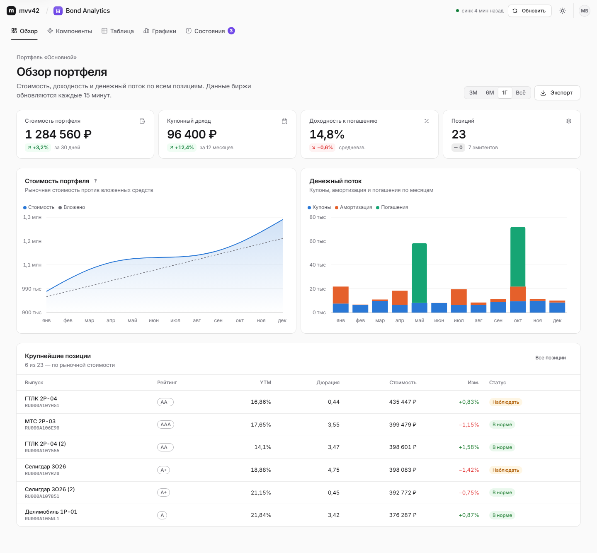
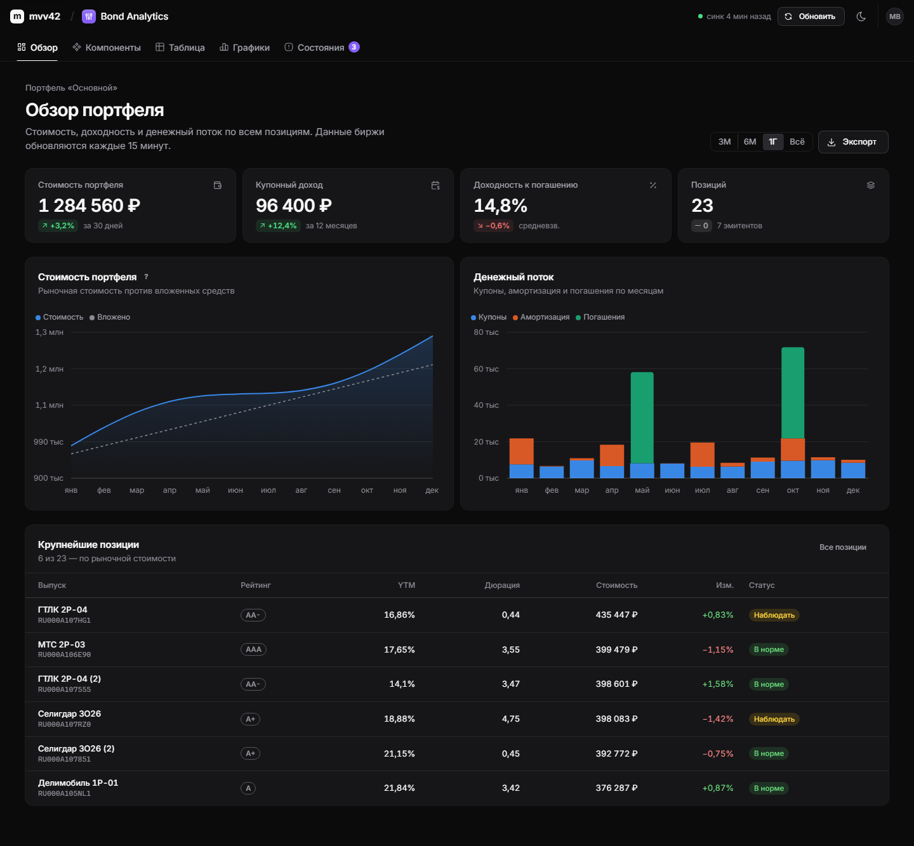
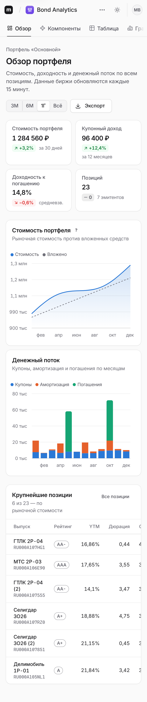
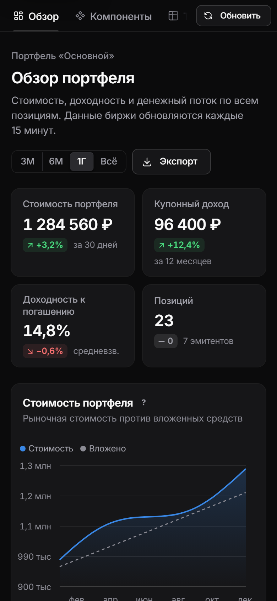
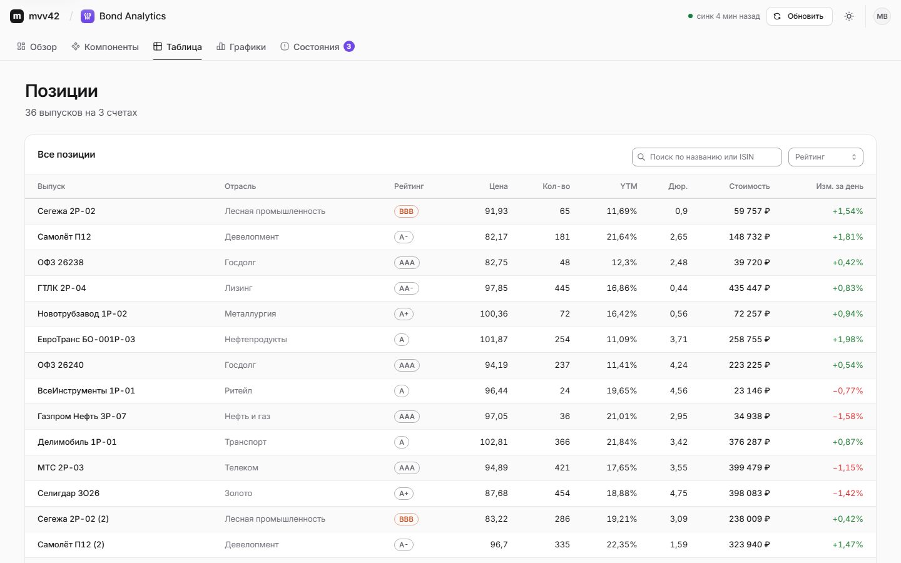
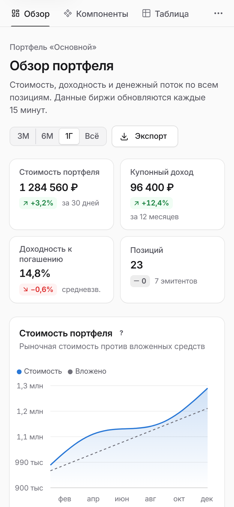
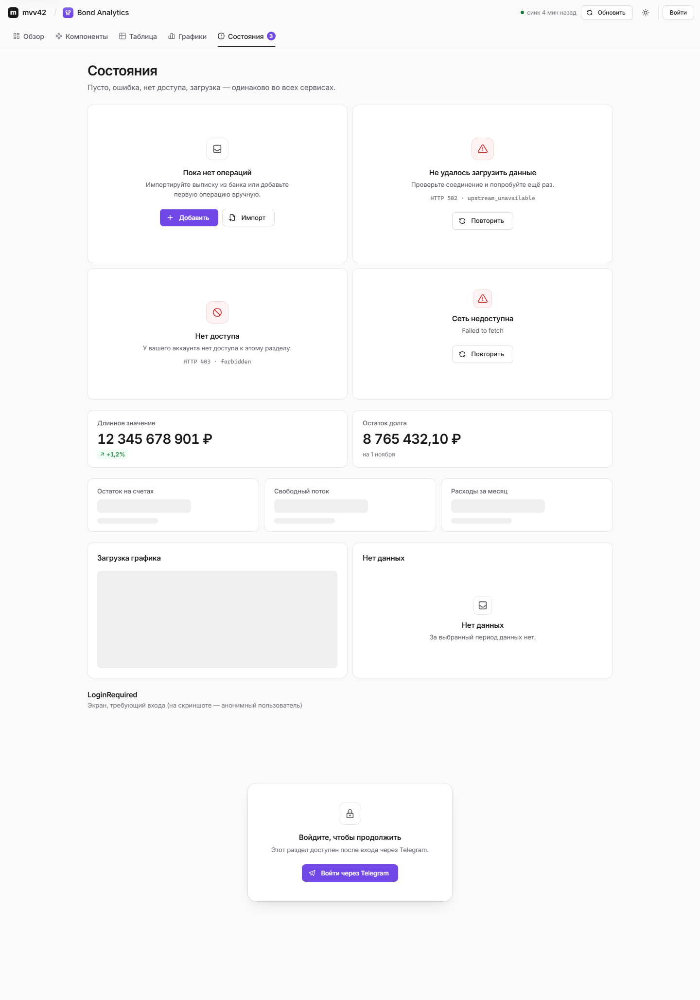
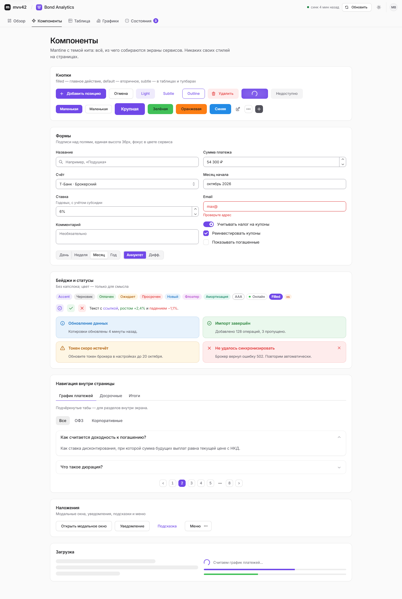
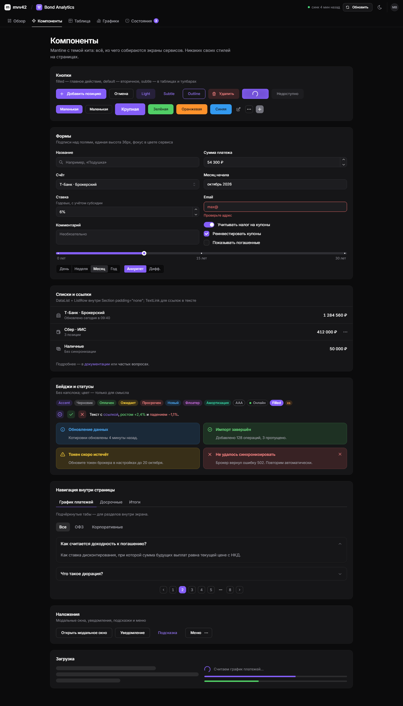
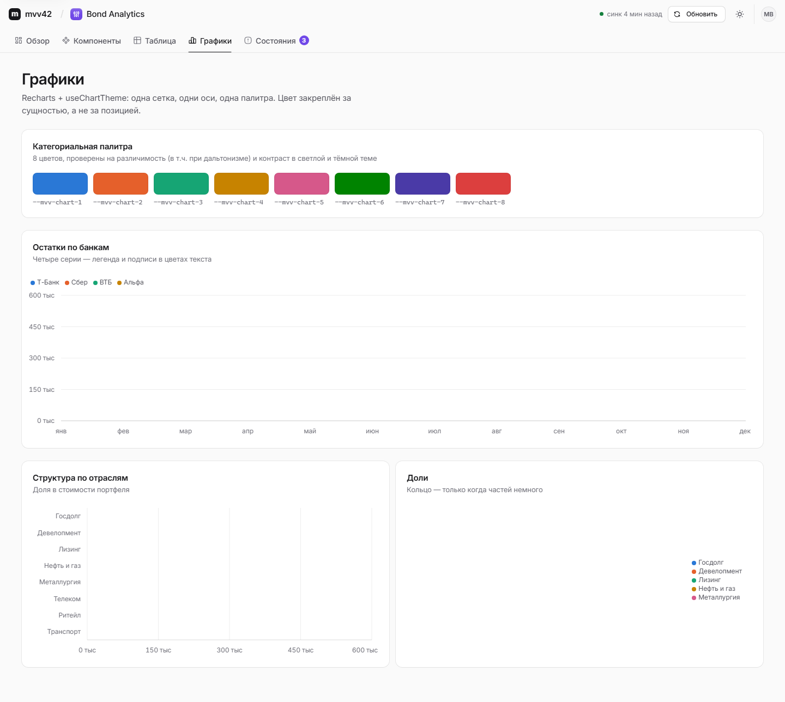

# @mvv42/kit

Design kit of **mvv42.ru**: Mantine theme, tokens, layout components, chart conventions and the platform
client (shared auth + shell bridge). Every mvv42 frontend — the shell and each service — is assembled from it,
so a new service needs no bespoke design work: `Mvv42Provider` + `AppLayout` + `Page`/`Section`/`Metric` +
plain Mantine components.



| Dark | Phone | Inside the shell |
|---|---|---|
|  |  |  |

The language: restrained and quiet (Apple / Linear / Vercel) — zinc neutrals, hairline borders instead of heavy
shadows, Inter / SF, tabular figures for every number, one accent colour per service, status colour only for
meaning, the same in light and dark.

---

## Contents

- [Install](#install)
- [Set up a frontend](#set-up-a-frontend) — `index.html`, Vite, CSS, Provider, layout
- [Entries](#entries)
- [Components](#components) — catalogue with screenshots
- [Platform client](#platform-client) — `mvv42Fetch`, `apiJson`, `useMe`, shell protocol
- [Charts](#charts)
- [Theming rules](#theming-rules)
- [Building a new service](#building-a-new-service)
- [Development & release](#development--release)

## Install

The kit ships as a release tarball (works with npm and yarn v1, integrity lands in the lockfile, no git
dependency, no install scripts):

```jsonc
// package.json
"dependencies": {
  "@mvv42/kit": "https://github.com/max31000/mvv42-kit/releases/download/v0.1.0/mvv42-kit-0.1.0.tgz",
  "@mantine/core": "^9.4.0",
  "@mantine/hooks": "^9.4.0",
  "@mantine/notifications": "^9.4.0",
  "react": "^19.0.0",
  "react-dom": "^19.0.0",
  "react-router-dom": "^7.0.0",   // optional: @mvv42/kit/router
  "recharts": "^3.0.0"            // optional: @mvv42/kit/charts
}
```

Peers: `react@^19`, `react-dom@^19`, `@mantine/core|hooks|notifications@^9.4`; optional `@mantine/dates@^9.4`,
`react-router-dom@^7`, `recharts@^3`, `vite` (for the plugin). The Inter variable font comes with the kit.

Before a release exists, develop against a local pack: `npm pack` in this repo, then
`"@mvv42/kit": "file:../mvv42-kit/mvv42-kit-0.1.0.tgz"`. Switch to the release URL before opening a PR.

## Set up a frontend

**1. Vite** — inject the anti-flash colour-scheme script and dedupe the singletons:

```ts
// vite.config.ts
import react from '@vitejs/plugin-react';
import { defineConfig } from 'vite';
import { mvv42Html } from '@mvv42/kit/vite';

export default defineConfig({
  base: '/bonds/',
  plugins: [react(), mvv42Html()],
  resolve: {
    dedupe: ['react', 'react-dom', '@mantine/core', '@mantine/hooks', '@mantine/notifications'],
  },
});
```

`mvv42Html()` puts the colour-scheme script (and `<meta name="color-scheme" content="light dark">` if missing)
right after `<meta charset>`. It reads the shared `mvv42-color-scheme` key (falling back to the legacy
`mantine-color-scheme-value` and `cashpulse-settings` keys, then the OS) and sets `data-mantine-color-scheme`
before first paint.

Without Vite, paste this into `<head>` right after `<meta charset>` (identical to `colorSchemeInlineScript`):

```html
<meta name="color-scheme" content="light dark">
<script data-mvv42="color-scheme">(function(){try{var d=document.documentElement,s=localStorage,ok=function(x){return x==='light'||x==='dark'||x==='auto'},v=s.getItem('mvv42-color-scheme');if(!ok(v)){v=s.getItem('mantine-color-scheme-value');if(!ok(v)){v='auto';try{var c=JSON.parse(s.getItem('cashpulse-settings')||'null');c=c&&(c.state&&c.state.colorScheme||c.colorScheme);if(ok(c))v=c;}catch(e){}}}if(v==='auto'){v=window.matchMedia&&matchMedia('(prefers-color-scheme: dark)').matches?'dark':'light';}d.setAttribute('data-mantine-color-scheme',v);d.style.colorScheme=v;}catch(e){}})();</script>
```

With a Content-Security-Policy, allow it by hash: `script-src 'self' 'sha256-ZcaVJFYIVAnkUXiEq2ZbZrgHVGrV5Y8kNo8Z1qdRvwk='`
(also exported as `colorSchemeInlineScriptSha256`; the value changes only when the script changes — see the changelog).

**2. CSS** — Mantine first, then the kit (the JS never imports CSS; `sideEffects` keeps these imports):

```ts
import '@mantine/core/styles.css';
import '@mantine/notifications/styles.css';
import '@mantine/dates/styles.css'; // if you use @mantine/dates
import '@mvv42/kit/styles.css';
```

**3. Provider + layout:**

```tsx
import { Mvv42Provider } from '@mvv42/kit';
import { AppLayout, type NavItem } from '@mvv42/kit/router';
import { IconChartCandle, IconLayoutDashboard, IconList } from '@tabler/icons-react';

const nav: NavItem[] = [
  { label: 'Обзор', to: '/', icon: <IconLayoutDashboard /> },
  { label: 'Позиции', to: '/positions', icon: <IconList /> },
  { label: 'Сигналы', to: '/signals', badge: unread || undefined },
];

createRoot(root).render(
  <Mvv42Provider serviceId="bonds" accent="violet">
    <BrowserRouter basename="/bonds">
      <AppLayout title="Bond Analytics" icon={<IconChartCandle />} nav={nav} actions={<SyncStatus />}>
        <Routes>…</Routes>
      </AppLayout>
    </BrowserRouter>
  </Mvv42Provider>,
);
```

`Mvv42Provider` renders `MantineProvider` (kit theme for the accent, shared colour-scheme manager, token remap via
`cssVariablesResolver`), `Notifications`, the shell bridge and the kit context. **Remove your own
`<Notifications/>`, theme, colour-scheme switcher and auth store.** On startup it removes the old token keys
(`cashpulse-auth`, `bonds-auth`, `credit-calc-auth`) and, outside the shell, copies `mantine-color-scheme-value` /
`cashpulse-settings.colorScheme` into `mvv42-color-scheme` when that key is absent (legacy keys are left in place).

**4. Pages:**

```tsx
import { Metric, MetricGrid, Page, Section } from '@mvv42/kit';

export function Overview() {
  return (
    <Page title="Обзор портфеля" description="Стоимость, доходность и денежный поток" width="wide"
          actions={<Button variant="default">Экспорт</Button>}>
      <MetricGrid>
        <Metric label="Стоимость" value={rub(1284560)} delta={{ value: '+3,2%', tone: 'positive' }} hint="за 30 дней" />
        <Metric label="Купоны за год" value={rub(96400)} />
        <Metric label="YTM" value="14,8%" />
        <Metric label="Позиций" value="23" />
      </MetricGrid>
      <Section title="Крупнейшие позиции" padding="none">
        <Table>…</Table>
      </Section>
    </Page>
  );
}
```

## Entries

| Import | Contents | Needs |
|---|---|---|
| `@mvv42/kit` | `createMvv42Theme`, `Mvv42Provider`, `Page`, `Section`, `Metric`, `MetricGrid`, `EmptyState`, `ErrorState`, `LoginRequired`, `AccountButton`, `ColorSchemeToggle`, `UserAvatar`, `useMvv42Context`, `useInsideShell`, `useShellBridge`, `colorSchemeInlineScript`, `COLOR_SCHEME_KEY`, `tokens`, `icons` | Mantine |
| `@mvv42/kit/router` | `AppLayout`, `NavItem`, `useShellRouterSync` | `react-router-dom` 7 |
| `@mvv42/kit/platform` | `mvv42Fetch`, `apiJson`, `ApiError`, `getMe`, `useMe`, `refreshSession`, `requestLogin`, `logout`, `onShellMessage`, `postToShell`, `isInsideShell`, types `Me`, `Mvv42User`, `AppAccess`, `ShellMessage` | React only (no Mantine) |
| `@mvv42/kit/charts` | `chartColors`, `seriesColor`, `useChartTheme`, `ChartTooltip`, `ChartFrame`, `CHART_HEIGHT`, `CHART_HEIGHT_COMPACT`, `pickAxisTicks`, `axisTickAngle`, `useResponsiveChartSize` | `recharts` 3 |
| `@mvv42/kit/vite` | `mvv42Html()` plugin, `colorSchemeInlineScript` | Node |
| `@mvv42/kit/styles.css` | Inter, tokens (`--mvv-*`, light/dark), base, Mantine overrides, kit components | — |

The core entry never imports `react-router-dom` or `recharts`; CI checks it.

## Components

Live catalogue: `npm run playground` (http://127.0.0.1:5199, `?accent=blue|green|violet|…`, `?shell=1` simulates
the shell iframe). Screenshots (light/dark × 1440/390) are in [`docs/screenshots`](docs/screenshots).

### AppLayout (`@mvv42/kit/router`)

`{ title, icon?, nav: NavItem[], actions?, homeHref?, children }`, `NavItem = { label, to, icon?, badge?, end? }`.

- **Standalone**: 52px glass top bar — mvv42 mark → `/`, `/`, service tile in the accent colour + title, `actions`,
  theme toggle (auto → light → dark), `AccountButton`; under it a 44px strip of section tabs.
- **Inside the shell**: only the 44px sticky strip (tabs + `actions`); brand, theme and account are the shell's.
- Tabs are `NavLink`s (`aria-current="page"`, `end` defaults to `true` for `/`), focus ring on `:focus-visible`,
  ←/→/Home/End move focus, the active tab scrolls into view; on phones the strip scrolls horizontally with soft
  edge fades. Skip link «К содержимому» → `<main id="mvv-main">`. Posts `NAVIGATE` to the shell on route change.

| Standalone | Inside the shell (phone) |
|---|---|
|  |  |

### Page, Section, Metric, MetricGrid

- `Page { title?, description?, eyebrow?, actions?, width?: 'default' | 'wide' | 'full', gap? }` — 1080 / 1360 /
  full container with gutters; title row with actions (wraps on phones); children stack with a 24px gap.
- `Section { title?, description?, actions?, padding?: 'none' | 'sm' | 'md' | 'lg', variant?: 'card' | 'plain' }` —
  a labelled region on a hairline card. `padding="none"` lets a `Table` run edge to edge with its outer cells
  aligned to the header, and scrolls wide tables horizontally.
- `Metric { label, value, hint?, delta?: { value, tone: 'positive' | 'negative' | 'neutral' }, icon?, loading? }` —
  value in 28px tabular figures; delta chip with an arrow and a screen-reader tone.
- `MetricGrid { cols?: 1 | 2 | 3 | 4 }` — 4 → 2 columns under 900px, 1 under 360px.

### States

- `EmptyState { icon?, title, description?, action?, compact? }`
- `ErrorState { title?, error?, onRetry?, compact? }` — understands `ApiError` (401 «Нужно войти», 403 «Нет доступа»,
  404 «Не найдено») and shows `HTTP 502 · code` as a technical hint.
- `LoginRequired { title?, description?, children }` — uses the provider's `serviceId`: spinner → «Сервис входа
  недоступен» (busy retry) → «Войти через Telegram» → «Нет доступа» (signed in but not granted, or the service is
  missing from `/me` — that also logs a console warning) → children.
- `AccountButton` — standalone only: «Войти» or the avatar menu with «Выйти».



### Mantine, themed

Use Mantine directly — the kit theme restyles it. Highlights:

| Component | Kit defaults |
|---|---|
| Button | size `sm` (36px), medium weight, subtle top highlight on filled, `default` = surface + hairline |
| ActionIcon | `variant="subtle"`, `color="gray"` (pass `color`/`variant` for a coloured one) |
| Paper / Card | `withBorder`, radius `md`, surface background, hairline border |
| Table | `highlightOnHover`, `verticalSpacing="xs"`, tabular numbers, quiet 12px header, faint stripes |
| Inputs (Text/Number/Select/MultiSelect/Textarea/Autocomplete/Tags, `@mantine/dates` pickers) | 36px, label above in 13px, accent focus ring, 16px text on touch devices |
| Badge | `variant="light"`, pill, sentence case (no caps), translucent tint that works on any surface |
| Alert | `variant="light"`, tinted border, coloured title, neutral body text |
| Tabs | neutral underline / pills, SegmentedControl on a recessed track |
| Modal / Drawer | radius `lg`, centered, blurred scrim |
| Menu / Popover / Combobox / Tooltip | raised surface, hairline ring, large soft shadow; dark tooltips |
| Notification, Accordion, NavLink, Skeleton, Progress, Pagination, Switch, Checkbox | token colours |

`c="green"`, `c="red"` etc. use a shade with ≥ 4.5:1 contrast on the surface in both schemes; `c="dimmed"` is
`--mvv-text-3`.

| Light | Dark |
|---|---|
|  |  |

## Platform client

```ts
import { apiJson, ApiError, mvv42Fetch, requestLogin, useMe } from '@mvv42/kit/platform';

// JSON API: cookies, 401 → one shared refresh (Web Lock `mvv42-refresh` across tabs/iframes) → one retry.
const positions = await apiJson<Position[]>('/bonds/api/positions');
await apiJson('/bonds/api/positions', { method: 'POST', body: JSON.stringify(input) }); // JSON headers added

try { … } catch (e) {
  if (e instanceof ApiError && e.status === 401) requestLogin('bonds'); // final 401 → shell login
  if (e instanceof ApiError && e.status === 403) /* render <ErrorState error={e} /> */;
}

const { me, user, loading, status, app, refresh } = useMe(); // shared, re-reads on AUTH_CHANGED and logout()
```

| API | Behaviour |
|---|---|
| `mvv42Fetch(input, init?) → Response` | raw fetch, `credentials: 'same-origin'` for URLs (a `Request` keeps its own), 401 → refresh once → retry once |
| `apiJson<T>(input, init?) → T` | merges `Request`/`init` headers + `Accept: application/json`; throws `ApiError { status, code, message }` on non-2xx (`code` from `{ "error": "…" }`) and `code: 'invalid_json'` on a non-JSON 2xx body; `undefined` for 204 |
| `getMe() → Me \| null` | `null` = auth unavailable (network / non-200); `{ user: null }` = anonymous |
| `refreshSession() → boolean` | single-flight in the page + `navigator.locks` when available (falls back if it throws), 10 s timeout |
| `requestLogin(serviceId)` | inside the shell: `AUTH_REQUIRED`; standalone: `/?login=1&return=<path>` |
| `logout()` | `POST /auth/api/logout`, then `useMe` refresh here and in other same-origin documents (`BroadcastChannel('mvv42-auth')`, storage-event fallback) |
| `onShellMessage(handler)` | only same-origin messages from the parent window, validated |
| `type ShellMessage` | `READY` · `NAVIGATE` · `AUTH_REQUIRED` · `THEME` · `AUTH_CHANGED` |

`Me = { user: { id, telegramId, name, username, photoUrl, isAdmin, isOwner } | null, apps: { id, anonymous, access, granted }[] }`.

## Charts

```tsx
import { Area, AreaChart, CartesianGrid, Legend, Tooltip, XAxis, YAxis } from 'recharts';
import { ChartFrame, ChartTooltip, chartColors, useChartTheme } from '@mvv42/kit/charts';

function ValueChart({ data }) {
  const t = useChartTheme();
  return (
    <ChartFrame title="Стоимость портфеля" description="…" explanation="Как читать график…" empty={!data.length}>
      <AreaChart data={data} margin={t.margin}>
        <CartesianGrid {...t.grid} />
        <XAxis dataKey="month" {...t.xAxis} />
        <YAxis {...t.yAxis} tickFormatter={compact} />
        <Tooltip {...t.tooltip} content={<ChartTooltip valueFormatter={(v) => rub(v)} />} />
        <Legend {...t.legend} />
        <Area {...t.area} dataKey="value" name="Стоимость" stroke={chartColors.series[0]} fill={chartColors.series[0]} />
      </AreaChart>
    </ChartFrame>
  );
}
```

- `chartColors.series` = `var(--mvv-chart-1…8)`: a categorical palette validated with a CVD/contrast checker
  (adjacent-pair ΔE ≥ 8 under protan/deutan, normal-vision ΔE ≥ 15, ≥ 3:1 against the chart surface) and stepped
  separately for dark. Assign by **entity** in fixed order; never cycle — `seriesColor(8+)` returns
  `chartColors.other` («Другое»). Semantic `positive`/`negative`/`warning`/`info` are for meaning only.
- `useChartTheme({ height })` → props for grid/axes/legend (declaration order, neutral text)/tooltip
  (`tooltip` for lines, `barTooltip` for bars)/`line`/`area`/`bar`, plus `height` (compact on phones) and `maxTicks`.
- `ChartFrame` = `Section` + responsive `ResponsiveContainer`, `loading` / `error` / `empty` states, «?» explanation.



## Theming rules

1. **One accent per service**, equal to its registry tile: `cashpulse` blue, `bonds` violet, `credit_calc` green,
   shell zinc. Accents: `zinc`, `blue` (`[6]=#228be6`), `green` (`[6]=#40c057`), `violet` (`[6]=#7048e8`), `teal`,
   `orange`, `red`; `primaryShade` 6/5 (zinc 9/0); `autoContrast` gives green/orange buttons dark text.
2. **Colour means something.** Accent = primary action, selection, focus. Green/red = gain/loss or status, always
   with a sign, icon or label. Don't colour headings, cards or whole rows.
3. **No raw hex in pages.** Use Mantine props (`c="dimmed"`, `color="red"`), tokens (`var(--mvv-text-2)` or
   `tokens.text2` from `@mvv42/kit`) and `chartColors`. Tokens: surfaces `--mvv-bg|surface|surface-2|surface-hover|surface-active`,
   text `--mvv-text|text-2|text-3`, `--mvv-border|border-strong|focus-ring`, `--mvv-accent`,
   status `--mvv-success|warning|danger|info` (+ `-bg`), `--mvv-chart-1…8`, layout `--mvv-content-max|content-wide|topbar-h|subnav-h`,
   scales `--mvv-sp-*`, `--mvv-fs-*`, `--mvv-r-sm|md|lg|full`, `--mvv-shadow-xs…lg`, motion `--mvv-ease`, `--mvv-dur-fast|base|slow`.
4. **Structure, not decoration.** A screen is `Page` → `MetricGrid` / `Section`s. Sections are the only cards; don't
   nest cards; use `padding="none"` for tables and lists.
5. **Numbers** are tabular (`.mvv-num` outside tables), right-aligned in tables, full precision in tooltips.
6. **Copy**: sentence case, Russian, short. Empty states say what to do next.
7. **Colour scheme** is one setting for the whole site (`mvv42-color-scheme`). Services have no switcher of
   their own: the shell owns it; standalone `AppLayout` shows one. Inside the shell `THEME` is applied, never stored.
8. Extend through `theme` on `Mvv42Provider` (merged over the kit theme) rather than global CSS.

## Building a new service

1. `npm create vite@latest my-service -- --template react-ts`, add the dependencies above and `@tabler/icons-react`.
2. `vite.config.ts`: `base: '/<id>/'`, `mvv42Html()`, `resolve.dedupe`.
3. `main.tsx`: the four CSS imports, `<Mvv42Provider serviceId="<id>" accent="…">`, `<BrowserRouter basename="/<id>">`,
   `<AppLayout title icon nav>`.
4. Screens: `Page` + `MetricGrid`/`Section`/`ChartFrame` + Mantine controls; data via `apiJson`; wrap protected
   screens in `LoginRequired`; on `ApiError` 401 call `requestLogin`, on 403 render `ErrorState`.
5. Register the service in the shell registry (`"auth": "shared"`, tile colour = accent `[6]`).
6. Check light/dark × 1440/390 (Playwright with `page.route` mocks of `/auth/api/me`).

## Development & release

```bash
npm ci
npm run lint && npm run typecheck && npm test   # vitest + jsdom
npm run build                                   # tsup (ESM + d.ts) + dist/styles.css
npm run playground                              # http://127.0.0.1:5199
npm run playground:build && npm run screenshots # Playwright (python) → docs/screenshots
npm pack                                        # mvv42-kit-<version>.tgz (gitignored)
```

Release: bump `version`, commit, tag `vX.Y.Z`, push the tag. The `Release` workflow builds, tests, packs and
attaches `mvv42-kit-X.Y.Z.tgz` to a GitHub Release, then a smoke job installs that asset with npm **and** yarn v1
into a scratch Vite + React + Mantine app, builds it and asserts a single copy of `react` and `@mantine/core`.
An existing tag is never re-uploaded — fixes ship as the next patch. `dist/` is not committed; there are no
`prepare`/`prepack`/`postinstall` scripts.

## Changelog

### 0.1.1
- Release workflow smokes the packed tarball (npm + yarn v1) **before** publishing; CI checks the full chunk
  import closure of each entry (`npm run check:entries`).
- Platform: refresh has a 10 s timeout and survives a throwing `navigator.locks.request`; `mvv42Fetch` keeps the
  credentials of a `Request` input, `apiJson` merges its headers; a non-JSON 2xx body throws
  `ApiError(status, 'invalid_json')`; `requestLogin` keeps backslashes inside the return path (only a leading run
  of `/` and `\` collapses to `/`); `logout()` notifies other tabs/iframes (`BroadcastChannel` / storage).
- `useMe` re-reads `/me` when a component mounts after every subscriber had unmounted, and on auth broadcasts.
- Colour scheme: no migration inside the shell; legacy keys are copied, never removed; the inline script also
  falls back to `cashpulse-settings`. **New CSP hash** — `colorSchemeInlineScriptSha256` (exported from `@mvv42/kit`
  and `@mvv42/kit/vite`).
- `mvv42Html()` injects right after `<meta charset>`.
- `useShellBridge` follows the provider's `insideShell`; `LoginRequired` treats a service missing from `/me` as
  not granted and shows a busy retry; `ErrorState` gets `retrying`; the skip link focuses `<main>` without
  changing the URL.
- `package.json` exports gain a `default` condition.

### 0.1.0
- First release: theme, tokens, `Mvv42Provider`, `AppLayout`, `Page`/`Section`/`Metric`/states, charts, platform
  client, `mvv42Html()`.

MIT © Max Vodopianov
